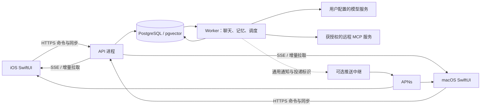

# 技术架构与实现约束

状态：2026-10-11，P1–P5 已实现，P6/T13 已授权并实施容量优化；未通过验收仍为交付约束。实测与限制见 [P6 实施记录](p6-report.md)，不能将下述未来能力当成现有实现。产品范围见 [产品与决策](product-and-decisions.md)，执行顺序见 [任务](tasks.md)。

## 1. 系统组成

- 一个代码库，一个后端应用，API 与 Worker 使用同一镜像的不同启动入口。
- PostgreSQL 同时负责业务数据、pg-boss 持久任务、同步事件、预算与审计元数据。首版不部署 Redis。
- Docker Compose 至少包含反向代理、API、Worker、PostgreSQL；头像等资源使用挂载卷。资源接口抽象为 BlobStore，暂不引入 MinIO。
- 中继是单独的可选部署单元，拥有官方 APNs 凭证和设备路由；它没有业务数据库读取权限。
- 前台对话、定时触发、离线角色互动统一调用服务端 RunEngine，客户端不拼装最终提示词，不执行自主调度。

## 2. 技术基线

| 层              | 推荐                                                                                                                         |
| --------------- | ---------------------------------------------------------------------------------------------------------------------------- |
| Apple UI        | SwiftUI；共享 SPM 包；iOS 18 / macOS 15 起；Swift 6 并发检查                                                                 |
| Apple 网络/安全 | URLSession、Keychain、UserNotifications；REST 与可恢复 SSE                                                                   |
| Apple 缓存      | SwiftData；独立保存待发送命令与草稿；可完整清空并重建业务缓存                                                                |
| 后端            | Node.js 24 LTS、TypeScript strict、Fastify                                                                                   |
| 数据            | PostgreSQL 17、pgvector；node-postgres 参数化 SQL；编号 SQL 迁移                                                             |
| 契约            | TypeBox schema 为服务端类型与运行时校验来源，生成 OpenAPI；Swift OpenAPI 生成器生成 REST 类型/客户端，SSE 用 URLSession 适配 |
| 任务            | pg-boss，业务 outbox 弥合数据库提交与入队；持久任务状态不依赖内存                                                            |
| MCP             | 官方 TypeScript SDK；固定兼容的协议/SDK 版本，远程连接优先                                                                   |
| 测试            | Vitest + 实际 PostgreSQL 集成环境 + 模拟 LLM/MCP；Swift Testing/XCTest；真机通知测试                                         |
| 部署            | Docker Compose，Caddy 处理 HTTPS；提供 amd64/arm64 镜像                                                                      |

精确依赖版本在 T01 固定并生成锁文件。以上是建议主版本；T01 必须验证 SDK、Swift 生成器、数据库扩展和目标平台组合。不能因某个依赖不兼容直接换整套架构。

## 3. 领域模型

所有业务记录都有稳定 ID、创建时间、必要的修订号；时间在数据库存 UTC，日程另外保存 IANA 时区。首版单主人仍保存 `owner_id` 并使用带所有者约束的外键。

| 实体/拟建表                                            | 关键内容及职责                                                              |
| ------------------------------------------------------ | --------------------------------------------------------------------------- |
| owners / devices / device_sessions                     | 实例主人、设备、公钥/会话标识、撤销状态；首版不开放注册                     |
| provider_connections / model_profiles                  | 供应商端点、加密凭据、模型 ID、协议、能力、上下文上限、用途和可选价格       |
| character_templates / character_versions               | 可复用角色定义：姓名、描述、性格、语气、例句、场景、开场白；新编辑生成版本  |
| worlds / world_user_personas                           | 世界名称、背景、玩家虚构身份、当前剧情修订、现实时间与剧情时间模式          |
| world_characters                                       | 世界内角色实例，绑定特定模板版本；拥有本世界内经历，不与其他世界实例串记忆  |
| rooms / room_memberships                               | 私聊/群聊房间，成员进入/离开时间，参与权限；加入不默认获得加入前私密历史    |
| messages                                               | 房间、发言者类型与实例、正文、顺序、状态、run_id、来源命令、修订、可见性    |
| world_events / world_state                             | 已确认剧情事件及当前事实投影；区分客观事件、角色声称、用户修正和不确定推断  |
| lorebooks / lore_entries / lore_activation_state       | 世界书、条目、作用域、触发规则、注入位置及状态；原始导入字段保留            |
| memories / memory_evidence / memory_revisions          | 类型、内容、主体、作用域、知道此事的角色、证据、置信度、有效期、状态及修订  |
| summaries                                              | 房间滚动摘要与离线回顾，记录覆盖的事件范围和来源；摘要是可重建派生数据      |
| runs / run_steps / world_leases                        | 运行状态、任务类型、上下文版本、步骤、租约/栅栏序号及错误；不记录隐藏思维链 |
| autonomy_policies / scheduled_triggers                 | 世界自主开关、时间规则、预算、下一次唤醒时间、用户活动状态                  |
| mcp_connections / tool_grants / tool_calls / approvals | 外部连接、工具描述快照、授权、调用状态与待批准动作                          |
| usage_ledger / budget_reservations                     | 每次模型/工具的估计与实际消耗、预算预留、结算和未知用量                     |
| outbox / sync_events / sync_heads                      | 事务后待分发任务、按提交顺序可重放的客户端变更、每主人同步游标              |
| import_jobs / schema_migrations                        | 导入预览、兼容报告、批次幂等键、格式版本、数据库版本                        |

### 世界、知识、权限的硬约束

1. 一个世界可以有多个房间和角色。角色模板本身不携带跨世界的自动共享记忆。
2. 私聊秘密只能被当时获准的角色看到；后续进入群聊不自动公开。用户作为主人可以查看全部记录，但模型以当前角色身份检索时只能看到该角色被授权的内容。
3. 世界客观事实可以包含尚未公开的信息。`world_state` 不是默认广播给所有角色的系统提示词。
4. 从多个来源产生的记忆/摘要不能扩大可见范围；派生内容的可见主体不超过所有来源权限的交集，或拆成分别可见的条目。
5. 用户现实资料（如真实生日）与世界内 Persona（如吸血鬼身份）分开，后者不进入跨世界现实画像。
6. 角色说“门外有敌人”首先是角色声称，不自动写成世界事实；明确发生的剧情事件或用户确认才能推进对应事实。
7. 模型可以提出结构化变更建议，服务器根据允许字段、来源与修订号应用；不能直接运行任意 SQL 或改权限。
8. 角色卡、世界书、记忆、网页、MCP 返回均属于内容输入，不能授予现实工具权限或覆盖服务器访问控制。

### 首版剧情状态范围

首版维护地点、时间描述、角色在场情况、已确认事件和未完成话题。以受限、版本化 JSON schema 保存，不提供任意用户定义计算脚本。复杂物品系统、战斗数值引擎、可编程规则和全量事件重放延后。

## 4. 命令、任务与一致性

### 用户发消息

1. 客户端生成 `client_command_id`，将草稿放入本地待发送队列。
2. API 验证设备、世界/房间、长度、模型配置和幂等键。在同一事务保存命令、待处理用户消息、run 和 outbox。
3. 返回 `202` 及稳定的 `message_id`、`run_id`。这表示服务器已经接收，不等于模型已经完成。
4. Outbox 分发器把运行提交给队列。重复分发允许发生，run 的状态检查确保只进行一次业务提交。
5. Worker 获取世界租约，冻结角色/世界书/记忆/消息的相关修订，按顺序将命令纳入当前世界，确定发言者。
6. PromptCompiler 组装上下文；LLMAdapter 请求模型；工具调用交给 ToolGateway；流式片段按小批次保存并通知客户端。
7. 完成一个角色发言时，在事务内检查租约栅栏及世界修订，写入完成消息、剧情事件/经验证的状态补丁、usage、sync_events 和后续 outbox。
8. 按群聊上限决定下一个发言者。最后安排记忆整理、必要摘要和通知。

### 并发规则

- 同一世界只有一个推进剧情的活跃运行；不同世界可并行，实例并发数由配置限制。
- 运行期间收到的用户消息先可靠排队并显示待处理；用户命令优先于尚未开始的后台运行。
- 无人互动在每个角色发言的边界检查新用户命令；当前一步结束后让出，不无限接力。
- 数据库行锁只用于短事务，不跨越 LLM/MCP 网络等待。
- 世界租约含递增 `fencing_token`。重启后旧 Worker 的迟到结果无法提交。
- 等待用户批准工具时释放运行租约；批准后重新检查授权、动作参数和状态版本。已过时的动作重新规划/再次确认，不能照原计划执行。
- 在保存角色/世界书/剧情纠正等编辑时使用 `If-Match` 修订。冲突返回 `409`，客户端展示新旧值，不静默覆盖。
- 任务系统是至少一次投递；数据库业务写入利用唯一键和状态 CAS 幂等。LLM 消耗与外部系统的副作用不具备事务性的恰好一次保证。

### 运行状态机

`queued → running → awaiting_approval / completed / failed / cancelled / interrupted`

`awaiting_approval → queued` 仅在批准有效且重新验证后；超时进入 `cancelled`。工具请求超时但可能已执行时，该工具步骤为 `outcome_unknown`，运行进入待人工处理状态，不自动重发。

- 从未输出可见片段、未执行工具的临时模型失败可自动重试，最多 2 次并计入消耗。
- 已有部分文本后崩溃：保留正文，标明未完成；不得用透明重试拼接成看似完整的新回复。
- 用户手动重试创建关联的新 run；已产生真实副作用的步骤不能随聊天重新生成而重放。
- 取消阻止后续生成与提交；对于已经发出的现实工具请求，只能报告状态，不能承诺撤销。

## 5. 角色、群聊与提示词

### 发言者选择

- 用户显式点名/@ 的角色优先；多次点名仍受每轮最大回复数限制。
- 没有点名时，按当前房间成员、在场状态、最近发言顺序、参与度和冷却选择。随机性必须记录种子，测试可重放。
- 每个角色独立调用模型，后续角色看到已提交且对其可见的前序回复。
- 不将所有角色的私密设定、记忆和工具权限放到同一次共享 prompt 中。
- 用户可指定“只让某角色回应”或手动继续；首版不依赖额外的导演模型决定每轮所有发言。

### PromptCompiler 顺序与预算

固定骨架：运行约束 → 当前角色版本/语气 → 用户世界内 Persona → 对当前角色可见的世界书与当前状态 → 固定核心记忆 → 按需回忆/摘要 → 近期可见消息 → 本轮输入和可用工具。

- 世界书可选择“角色设定前/后、历史前、历史深度”这些逻辑槽位；不能越过平台运行约束成为最高信任指令。
- 先预留模型输出预算和工具 schema 开销，再分配上下文；无法容纳必需骨架时明确报错，不静默裁掉角色核心设定。
- 从低优先级召回、较旧上下文和低优先级世界书开始裁剪；保留完整 tool-call/tool-result 对。
- 保存 PromptManifest：引用 ID/修订、纳入/排除原因、token 估计、模型能力和模板版本。默认不持久化整份含隐私内容的原始 prompt。
- 稳定信息保持固定顺序；本轮动态内容放在后部，减少缓存失效。跨供应商不承诺相同的缓存计费。
- 不支持工具或结构化输出的模型走明确能力降级；绝不把普通文本伪装成已经执行的工具调用。

## 6. 世界书与导入

### 首版条目字段

`id, book_id, enabled, content, visibility, keys, match_mode, case_sensitive, scan_depth, constant, priority, insertion_slot, injection_depth, sticky_turns, cooldown_turns, delay_turns, revision, raw_extensions`

- 扫描深度默认 8 条可见用户/角色消息，最大 50 条；工具返回和合成注入不计入扫描。
- 首版支持 OR 关键词、常驻条目、安全正则、固定优先级、注入位置/深度、sticky/cooldown/delay。复杂递归、概率、二级组合规则暂不执行。
- 正则使用无回溯爆炸风险的 RE2 兼容语义；不支持的表达式在导入预览中标记，不执行任意 JS 正则。
- 世界书预算默认占可用输入预算 20%，可配置绝对 token 上限。必需条目超限要显示错误或明确裁剪报告，不能隐性覆盖。
- 触发状态按世界内房间和有效剧情轮次维护；只在对应发言提交成功后推进。预览、重试和只读查询不消耗 sticky/cooldown。
- 先按角色可见性过滤，再触发；全局扫描不能通过关键词泄露私聊内容。

### 格式兼容

- 角色卡：JSON 和 PNG `chara`/`ccv3`，实现已声明的公共字段映射，保留不支持扩展。
- 世界书：支持指定版本酒馆 JSON 的上述规则子集；导入必须先预览新增、冲突和不支持项，由用户选择继续或取消。
- 未支持功能标记为“不执行”，不能谎称完全兼容。宏只允许明确白名单变量，不执行脚本、远程代码或任意模板函数。
- 导入输入限制建议：JSON 5 MiB、PNG 10 MiB、单文件最多 2,000 条世界书条目；解码/解压有独立上限；不会自动请求导入文件中引用的任意 URL。
- 以文件哈希+目标世界+导入版本形成幂等批次；失败事务不留下半个世界书。
- 从 Kelivo 或酒馆完整迁移聊天历史是后续功能；首版提供自身数据导出恢复和角色/世界书兼容导入，不承诺完整竞品迁移。

### 首版导入字段映射基线

角色卡首先校验声明的 `spec`/`spec_version` 及 `data`；PNG 中同时存在 `ccv3`/`chara` 时优先可解析且版本受支持的 `ccv3`，有冲突必须报告。不能只因为能读取 PNG 文本块就认定内容合法。

| 外部字段                                          | 内部处理                                                                                     |
| ------------------------------------------------- | -------------------------------------------------------------------------------------------- |
| `name, description, personality, scenario`        | 角色版本同名语义字段；场景只作为初始角色背景，不直接覆盖当前世界状态                         |
| `first_mes, alternate_greetings`                  | 保存开场白候选；用户创建会话时选用，不在导入时自动产生剧情                                   |
| `mes_example`                                     | 保存为示例对话内容；不当作曾经发生的记忆                                                     |
| `system_prompt, post_history_instructions`        | 保存为角色提示词覆盖建议，在预览中单独显示，默认关闭，需用户明确启用；始终低于运行与权限约束 |
| `character_book`                                  | 转成关联世界书，按同一兼容子集处理                                                           |
| `creator_notes, tags, creator, character_version` | 元数据，仅描述，不注入角色知识                                                               |
| 未支持 `extensions` / v3 额外字段                 | 保留原始JSON，不执行，报告字段路径                                                           |
| 世界书 `key, content, constant, disable`          | 映射触发词、内容、常驻、启用；`disable`取反                                                  |
| 世界书 `order, scanDepth, caseSensitive, depth`   | 映射优先级、扫描深度、大小写、注入深度；输入不合法则列为需修复，不静默改成别的语义           |
| 世界书 `position`                                 | 本次核实的酒馆0/1/4分别映射角色设定前/后/历史深度；2/3/5/6/7等槽位首版不执行并提示           |
| 世界书 `sticky, cooldown, delay`                  | 映射已声明的剧情消息轮次语义；报告与原项目计数语义的差异，不声称完全相同                     |
| 二级关键词、递归、概率或脚本行为                  | 保留原始字段，相关行为不执行；若条目依赖这些条件则默认不启用，避免意外扩大触发范围           |

优先级排序方向、缺省值和关键词中正则语法需以固定外部fixture验证并写入导入适配器测试；内部统一使用数值越大越优先的规则。导入预览必须指出字段映射和不执行行为，不能默默改变剧情设定。

## 7. 记忆与剧情事实

### 三层内容

1. 当前工作上下文：近期消息、当前场景、未完成话题，窗口有限。
2. 长期记忆：用户声明、角色经历、关系事件、偏好、约定；带来源和作用域。
3. 摘要/回顾：对可见事件的压缩视图，随原始事件删除或纠正失效，不能成为唯一真相。

### 写入流程

已完成对话事件 → 持久整理任务 → 按游标读取未整理范围 → 结构化提取候选 → 来源和知识权限检查 → 检索近似条目 → 新增/合并/冲突/忽略 → 事务提交 → 异步更新嵌入。

- 每条候选必须引用有效的 source event/message ID；禁止凭空生成无来源的“共同回忆”。
- 单凭角色主观表述提取的内容保留 claimed 状态，不能覆盖用户明确纠正或已确认世界事实。
- 用户手动修正优先；自动任务持有的旧修订不能覆盖新的人工修正。
- 事实变化通过 superseded/valid_from/valid_to 表达；关系状态不简化成模型任意累加的好感度分数。
- LLM 提取输出需要 schema 校验；失败最多有限重试，保留未处理游标和错误，不推进到看似已整理。
- 当前已完成消息足够进入短期上下文，不等后台记忆提取才回复。

### 检索

先按 owner/world/actor/audience/status 过滤，再结合精确实体、词项、向量相似度、时间与重要度检索；重排后受 token 预算约束。

- 首版不使用 PostgreSQL 默认英文分词器宣称中文全文检索已解决。提供中文友好的实体/字符 n-gram 候选方法，并用中文合成数据评测。
- pgvector 只存当前嵌入模型版本的向量；切换模型需新版本重建索引，完成前保留旧索引或退化为词项检索，不混用不同维度向量。
- 嵌入模型可不配置。降级模式仍提供核心记忆、实体与词项召回，界面明确提示语义召回未开启。
- 所有派生索引从权威内容重建；索引任务重试不会复制同一记忆。
- 删除/忘记必须写入失效标记，排除正在进行的提取任务，清除对应向量与派生摘要；不得因旧任务迟到而“记回来”。

### 剧情修改与重生成

首版支持最后一轮的受限重生成：没有被后续事件依赖、没有真实工具副作用时，可以标记原轮失效并失效其派生记忆，创建新运行。更早历史的修改以用户纠正事件追加，保留来源，不做全世界时间旅行。

用户主动删除原始内容属于隐私删除：相关派生数据同步失效；其他角色曾据此产生的后续故事可能无法自动修复，界面明确提示需要剧情纠正。不得将“审计”当作永久保留用户已删除正文的理由。

## 8. 主动消息与无人剧情

### 授权层次

最终允许范围是：实例总开关 ∩ 世界开关 ∩ 任务类别 ∩ 角色能力 ∩ 工具授权 ∩ 当前预算。任何一层关闭立即禁止启动后续步骤。

任务类别分开配置：整理记忆、主动联系用户、角色间互动、读取外部工具、写入外部工具。开角色间互动不会自动启用现实写入。

### 调度过程

1. 根据下一次检查时间/已承诺时间/新事件生成候选，不对每个角色频繁轮询模型。
2. 规则先过滤：静默时段、用户刚活跃、正在聊天、频率上限、世界暂停、预算、重复主题、过期触发。
3. 仍需判断时，允许一次受预算限制的模型决策，输出 `skip` 或结构化运行意图；`skip` 是正常结果。
4. 执行与前台相同的 RunEngine；开始与提交时都检查开关版本，避免关闭后迟到消息发布。
5. 无人互动每个世界分批执行，限制角色消息条数；不从自动回复递归触发无限新任务。
6. 用户返回时，按未读事件范围生成/复用回顾；列出发生时间、角色和可跳转的来源。使用已发生事件，不补写未经执行的经历。

安静时段默认同时抑制主动联系和无人剧情，自动记忆整理可运行；用户可明确允许安静时段推进剧情但不通知。剧情时间默认按已提交事件推进，与现实调度时间分开，不把现实一夜自动解释成剧情一天。

### 预算实现

- 生成前预留请求次数、输入估计和输出上限；事务检查全局、世界和任务类别预算。
- 完成后用供应商 usage 结算；usage 缺失时保守计费，不假设零消耗。
- 重试也计入预算。后台任务包含记忆/摘要，不只计算主动消息。
- 可显示 token 与调用数；货币成本仅在用户设置价格时估算，并标注估算。BYOK 不需要支付账单模块。
- 预算满或模型不可用时保留待处理状态，不把积压任务一次性全部补跑。

## 9. MCP 外部工具

只实现本应用作为 MCP client。角色不直接持有 MCP 网络连接和凭据，调用统一通过服务端 ToolGateway。

### 调用路径

模型请求工具 → 连接/角色/世界授权检查 → JSON schema 校验 → 风险与参数范围判断 → 必要时保存 approval → 执行 → 限量解析结果 → 以非可信工具结果回送当前运行 → 记录执行状态。

- 使用 SDK 完成连接生命周期、发现、协议版本协商；首版支持远程 Streamable HTTP 和所声明的旧 SSE 适配。
- 首版支持显式 Bearer/API Key 等连接凭据；完整通用 OAuth 授权流程不是首版必需项。不能把需要 OAuth 的服务器标为已兼容。
- 工具授权绑定连接、工具名、schema 指纹、角色/世界、允许的资源/参数与期限；工具定义改变时原授权失效。
- MCP 的 readOnlyHint/destructiveHint 等是提示，不是可信权限证据；不能仅凭服务端声称只读就自动放行。
- 读取也需要用户授权；现实写入默认逐次批准。用户可以建立具体范围的长期授权，例如某一日历的新增提醒；删除/发送/购买等不能因为自主总开关而默许。
- Approval 绑定工具、参数 hash、授权版本、必要的世界状态 revision；默认 24 小时到期。用户选择批准前能看到实际动作和影响对象。
- 执行前再次检查开关和授权。授权过期、参数变化、工具 schema 变化都重新确认。
- 工具输出按字节/token 限制并标记截断；首版只处理文本与结构化结果，不自动下载任意二进制或执行返回代码。
- 默认单次工具结果最多32 KiB且不超过4,000估计token，先达到者生效；JSON参数最多16 KiB；单连接最多向一个运行公开32个已授权工具。超过上限给出可见限制，不无限扩充上下文。
- 禁止凭据被放入模型可见参数、普通日志、备份明文或用户导出的角色卡。
- 对无幂等能力的写工具，网络超时后状态为 outcome_unknown；不自动重试，以免重复发信/创建/删除。

### 自部署网络边界

默认拒绝 MCP/模型/附件外联访问云元数据地址、link-local、未知内网网段和重定向后的越权目标。自部署用户需要调用内网服务时，管理员按连接显式允许特定主机/CIDR；不提供全局“忽略所有检查”。

解析 DNS 后验证目标，重定向后重新验证；连接凭据不跨 origin 转发。SDK 版本是否支持所需重定向和超时控制要在 T09 实测，无法约束时在受控 HTTP transport 层完成。

## 10. API 与同步契约

统一前缀 `/v1`，JSON 使用 snake_case；时间 ISO 8601 UTC，分页与游标是不透明字符串。错误响应统一含 `code, message, request_id, retryable, details`，details 不含密钥或未授权正文。

| 接口族                                                                      | 用途与关键语义                                                                                                           |
| --------------------------------------------------------------------------- | ------------------------------------------------------------------------------------------------------------------------ |
| `GET /health`、`GET /v1/capabilities`                                       | 健康与协议能力；不泄露部署密钥/内部路径；能力含 server_instance_id 和协议版本                                            |
| `POST /v1/pairings/claim`                                                   | 一次性配对；限速，返回设备会话；不是公共注册                                                                             |
| `POST /v1/pairings`、`POST /v1/sessions/refresh`、`DELETE /v1/devices/{id}` | 已授权设备生成新配对码、刷新令牌、撤销设备                                                                               |
| `/v1/providers`、`/v1/model-profiles`                                       | 端点与模型配置、能力测试；读取接口只返回凭据是否存在/掩码                                                                |
| `/v1/characters`、`/v1/worlds`、`/v1/worlds/{id}/characters`                | 角色模板、世界、世界内实例和配置修订                                                                                     |
| `/v1/worlds/{id}/rooms`、`/v1/rooms/{id}/members`                           | 私聊/群聊及成员权限                                                                                                      |
| `POST /v1/rooms/{id}/messages`                                              | `client_command_id, content, addressed_actor_ids`；202 返回 message/run ID；相同键相同请求返回同一结果，不同正文返回 409 |
| `GET /v1/rooms/{id}/messages`                                               | 按服务端稳定顺序分页；不依赖设备时钟排序                                                                                 |
| `/v1/runs/{id}`、`POST /v1/runs/{id}/cancel`                                | 状态、取消；可重复取消；取消不宣称撤销外部动作                                                                           |
| `/v1/worlds/{id}/lorebooks`、`/v1/memories`、`/v1/worlds/{id}/state`        | 带修订的内容操作；模型运行另走角色上下文权限过滤                                                                         |
| `/v1/imports/preview`、`/v1/imports/{id}/commit`                            | 兼容性报告、明确提交、幂等批次                                                                                           |
| `/v1/worlds/{id}/autonomy`、`/v1/worlds/{id}/recaps`                        | 分项开关、预算和回顾                                                                                                     |
| `/v1/mcp/connections`、`/v1/tool-grants`、`/v1/approvals`                   | 工具配置、授权、待审批及批准/拒绝；不是对外 MCP 协议入口                                                                 |
| `GET /v1/sync/snapshot`、`GET /v1/sync?cursor=...`、`GET /v1/events`        | 初始快照、增量恢复、SSE；游标过期返回 410，要求安全重建缓存                                                              |
| `/v1/exports`、`/v1/usage`                                                  | 自身数据导出、消耗；恢复在维护模式工具执行，不提供无保护的公网数据库恢复入口                                             |

列表查询使用固定最大页大小；所有写请求有限制正文大小。具体响应 schema 和契约样例由 T01 创建，T03 后不允许无版本地修改已发布字段语义。

### 同步与离线

- 业务提交与对应 sync_events 同事务。每 owner 的 sync_heads 行锁短时分配游标，使客户端不会因数据库序列分配顺序不等于提交顺序而漏掉事件。
- SSE 使用这些持久游标作为 event ID；断线后从上次已落本地缓存的 ID 恢复，不只从最后显示的 token 恢复。
- 流式片段按约 250ms 或达到大小阈值批量保存；最终消息有明确 completed 事件。不是逐 token 写事务。
- SSE 只改善实时体验；客户端重启/连接恢复均可通过 REST 拉取最终状态。APNs 不是同步日志。
- 增量事件默认保留 7 天；旧游标返回 410。快照在一致性读视图内返回状态和 high_water_cursor；清理旧服务端缓存后重建，草稿不丢失。
- 客户端缓存命名空间包含 server_instance_id、data_epoch、owner_id。切换服务器或从备份恢复后的 epoch 改变必须重新验证缓存。
- 离线发送显示待发送；联网后幂等重试。离线不生成权威剧情和记忆；原始草稿与发送成功后的业务记录分开。
- 角色/世界配置冲突采用版本冲突界面，不做静默最后写入者覆盖。

## 11. 认证与隐私

- 首次部署在本机管理入口生成短期一次性配对码；公网没有“抢先创建主人”的无保护接口。
- 第一台已配对设备可生成新设备配对码，默认 5 分钟有效、单次使用、失败限速。
- 短期访问令牌 + 可轮换刷新令牌；服务器只保存刷新令牌的哈希，可按设备撤销；客户端存在 Keychain。
- 生产 API 仅 HTTPS。不能在发布客户端中默认忽略证书错误；私有 CA 必须由用户在系统中正确信任。
- 模型/MCP 凭据在服务器以认证加密保存，主密钥通过部署 secret 注入，不进入数据库导出、镜像或 Git。主密钥轮换有版本和再加密流程。
- 客户端配置 Key 时明确说明它会被发送到用户指定的服务器用于后台运行；以后读取配置不返回原 Key。
- 云端需要可解密上下文才能运行模型。对静态存储加密、TLS 和最小权限作准确承诺，不将此称为服务器零知识的端到端加密。
- 默认诊断只记录 ID、状态、耗时、token、错误类别和权限决定；完整请求调试显式开启、有期限、可删除，禁止上传到公共遥测。
- 内容删除需同步清除索引、摘要、缓存及未来任务引用；备份保留策略明确说明旧备份的生命周期，不能承诺已删除数据瞬时从所有离线备份消失。

## 12. 通知中继

- 由官方签名 App 将 APNs token 注册给中继，取得不透明投递句柄；自部署后端只使用限定用途的投递票据。
- 绑定流程必须证明设备已授权该服务器投递；票据绑定 app topic、环境、设备和实例，具有撤销、过期及频率限制。不能让任意人凭可猜 ID 向用户发通知。
- 中继不存模型 Key，不接收聊天、世界书、记忆、角色名或摘要；使用固定通用文案和随机通知标识。实例/设备路由、时间等元数据仍需在隐私说明中披露。
- 推送在消息已持久化后发送；中继/APNs 成功仅表示接受请求，不代表用户已经看到。
- 不以静默推送驱动工作进程。不启用通知、设备离线、中继故障时，消息和剧情照常保存，打开 App 后同步。
- 通知点击先认证，再从用户服务器拉取对应事件；中继不代替服务器返回正文。
- 自签名用户可运行同样的开源中继并配置自己的 APNs 团队/Bundle ID；不能为官方 App 使用无关团队的凭证。
- 真机验证前，不承诺锁屏、强退、专注模式或系统节流下的即时送达。

## 13. 部署、升级与恢复

- 推荐起始环境：Linux amd64/arm64，2 vCPU / 4 GiB RAM，足够持久磁盘；这是待压测的起点，不是容量承诺。
- 配置包括公共 URL、数据卷、数据库密码、主加密密钥、可信内网目标、可选中继 URL；示例配置没有真实密钥。
- 镜像使用版本标签和 digest，避免无约束 latest。开发阶段锁 Node/npm/Swift 工具链；数据库及扩展升级单独说明。
- 迁移使用 PostgreSQL advisory lock 保证单执行者；不能让 API/Worker 各自盲目并行迁移。
- 优先 expand/contract 迁移：先兼容增加，再迁移数据，再在后续版本删除旧结构。发布前备份并确认上一应用版本可否读取新 schema。
- 备份包含数据库、资源卷、格式版本、校验和；恢复另需主密钥。文档明确只备份数据库不能恢复加密凭据。
- 恢复在维护模式执行，先预览和验证，再切换；更新 data_epoch，撤销或重新验证设备和中继票据。绝不让备份与原实例同时自主执行同一世界。
- schema 向后兼容时可回退镜像；不可逆数据迁移必须恢复备份到隔离实例验证后切换。不能靠运行相反 SQL 假装可靠回滚。
- 自主任务/MCP/推送都有独立运行开关；发现问题先停止新任务，保留数据和状态用于诊断。

## 14. P1 实现边界

P1 已落地设备配对/撤销、加密模型配置、持久文本命令、pg-boss/outbox、世界租约与 fencing、流式保存、usage、取消、快照/增量/SSE。模型仅支持 OpenAI-compatible 文本流，能力标记为 declared；接到工具调用明确拒绝，不伪称执行。角色上下文、PromptManifest、世界事件/知识权限、自动后台预算和 MCP 属于后续任务。

前台每日请求数通过 UTC 日账本预留，每个模型尝试计一次；缺失消耗为 unknown。模型上下文使用 UTF-8 字节数的保守上界与消息开销检查，超过预算明确失败。P1 保留最近至多 100 条已完成历史与本轮输入，不将未来排队输入混入当前 prompt。背景模型整理尚未启用。

P1 交付时同步事件尚不自动过期；P2 已补充七天保留清理、固定水位分页和 Apple 缓存。密钥版本已绑定认证加密，P5 已交付实际再加密轮换与停服隔离恢复，步骤见 [恢复指南](recovery.md)。

## P2 实现落点

P2 的精确数据表、受众冻结、配置历史、发言步骤、状态纠正、快照分页/过期与软删除语义见 [实施记录](p2-report.md) 和 [使用说明](p2-usage.md)。`worlds.persona` 存世界内玩家身份，基础世界书以 `lore_entries` 保存；P3 已加入完整触发状态；条目继续扁平组织，导入批次关联原件，不增加独立容器 UI（ADR-016）。该物理表组织不改变角色/现实资料/世界经历的隔离边界。

当前 `world_state` 的一组受限状态共享受众列表；模型声称只进入 `world_events`，不直接提出或应用模型状态补丁。未来加入自动剧情提案仍需 schema、来源和修订验证。`configuration_revisions` 保存可重建的配置版本，`prompt_manifests` 仅保存来源与预算，不保存完整 prompt 或隐藏推理。

P3 物理表与行为：`memory_sources/memory_jobs` 保存每房间处理水位和租约；`memories/memory_evidence/memory_revisions` 为权威记忆；`memory_tombstones` 与世界 `memory_epoch` 阻止迟到恢复；`message_dependencies` 保存实际 prompt 来源边；`memory_vectors` 绑定内容修订及索引版本，权限过滤后精确检索。`background_daily/background_usage` 预留并记录整理/嵌入消耗；`lore_activations/lore_commits` 与最终角色回复同事务提交；`import_jobs` 保存原件、预览和幂等结果。精确语义与限制见 [P3 使用说明](p3-usage.md)。

## P4 实现约束补充（ADR-017）

- 自主策略存于 `autonomy_settings/autonomy_policies`，按修订验证；调度只保存一批当前机会。前台工具单独取实例/世界工具权限，后台工具叠加自主总开关/世界/类别。分层预算按 IANA 日期以同库行锁预留；所有者命令锁用 `FOR NO KEY UPDATE` 避免与并发记忆用量外键检查形成锁环。
- 工具调用是 run 内的持久检查点，一次一个。审批及未知结果进入 `awaiting_approval` 并释放世界租约；持久 transcript 只在原角色/步骤继续，保留完整 call/result 对。执行前在线发现比较指纹，dispatch 前先写 executing，任何不确定副作用不自动重发。
- `tool_calls` 保存授权快照、参数指纹、修订、审批决定与时间、实际 dispatch 时间、有限结果和状态。网络原始错误不落业务日志，凭据回显在入库/模型上下文前移除。
- 内网许可为每连接精确 IP；尚无 CIDR 配置。MCP 的 schema 支持显式安全子集，不支持项禁止调用。SDK、协议和认证范围以 [P4 使用说明](p4-usage.md) 为准。
- 回顾直接按有效世界事件提取实际完成消息，分页/已读修订保存在策略记录；不增加模型摘要或第二套剧情事实。原文失效/遗忘同步影响回顾和工具 transcript。

## 16. P5 实现补充

`005_notifications_and_operations.sql` 加入设备 challenge/加密票据、随机通知事件/投递与撤销队列、维护状态、Worker 心跳和无正文删除 ID 清单。业务 worker 独立运行通知循环；完整消息、来源检查和安静时段决定是否入队，外部请求不占事务。相关 API 为 `/v1/notifications`、`/v1/notifications/binding`、`/v1/notifications/:id`、`/v1/exports` 和 `/v1/diagnostics`，均由设备认证限定权限。推送配置/票据不加入全设备同步。

`packages/push-relay` 使用独立 schema/推荐独立数据库与主密钥，通过 Node HTTP/2 和 P-256 JWT 调用 APNs。官方平台密钥只挂载于中继；多 topic 明确白名单、sandbox/production 分开，字段与限额见 [通知指南](notifications.md)。数据库恢复不是外部副作用回滚；停服锁、隔离空库、数据清单核验、epoch、撤销和删除记录重放见 [ADR-018](product-and-decisions.md) 与 [恢复指南](recovery.md)。

### P6 同步容量补充

分页快照保留同一 repeatable-read 水位与十分钟有效期。006 迁移增加 `record_count` 与带主键 `(snapshot_id,page_number)` 的 `sync_snapshot_pages`，每块 500 条，单页最多读两个块；父快照删除级联移除分块。原 `records` 保留作为 P5 回退/旧会话兼容路径，避免改动 v1 协议。创建仍全量物化，临时存储增加，不宣称无限容量。世界书按房间、角色、条目及修订一次关联 activation；权限过滤和提交计数不变。

## 17. 自有 App 规格第一批增量（ADR-022）

此节先记录 2026-10-14 首次增量，再补充本轮 T01–T06；当前状态和测试以 [规格实施进度](app-spec-progress.md) 为准。

- `operation_receipts` 在 owner/命令类型/operation ID 下保存内容摘要与无正文结果。owner 的 `FOR NO KEY UPDATE` 将去重检查与业务提交串行化，失败不留下成功回执。该封装只允许同库操作；外部工具继续使用原有持久意图/审批/unknown 状态机。
- `assets/asset_references` 分离原件和消息引用，owner/world/可选 actor 为资源作用域。当前小原件以最多 1 MiB 的 bytea 入库，hash/MIME 在相同作用域内去重，私有资产不能扩展消息受众。加引用、隐私删除、分支共享引用使用世界锁；删原件带 revision/预览 token，外键和运行时检查共同保护仍在引用的资源。
- `model_routes` 表示 inherit/override/disabled；subject 为 owner 或世界内 actor。每条线路有单独同步 ID 和 revision，当前只执行 chat。旧 room provider 为兼容回退。`run_route_snapshots` 在领取轮次时冻结所有成员非敏感连接参数，连接 revision 变化禁止沿用旧地址发送新凭据；工具权限仍在执行前动态复查。
- `message_versions` 由消息触发器保存稳定正文，`selected_version_id` 受延迟外键约束只能指向自己的版本。版本切换不重放工具。消息 edit 带 revision 和世界/房间水位摘要，保留后文标 context_stale，截断隐藏后文但不宣称永久擦除；erase 清除所有版本和派生原文、消费队列正文、旧同步事件/快照。
- `conversation_inputs` 保存手动聚合队列、创建时受众及版本，启动轮次将选定集合与新 run/outbox 在同事务绑定。32 条/16,000 字限额在服务端强制，运行期间不消费新输入；原生暂存草稿按现有设备连接 namespace 持久化。
- `conversation_branches` 保存分支来源，新房间复制完整所选回合之前的已完成可见消息，拥有独立消息/版本 ID。`runs.history_source_run_id` 区分复制历史与真实执行，不产生 outbox/用量或复制工具回执；任务领取和重生成拒绝重放这些历史记录。分支资产只增加引用。来源依赖继续用于隐私删除，不把独立编辑解释成隐私擦除豁免。
- `prompt_manifests` 增加被实际采用的消息 revision/选中版本、冻结线路及实际模型请求 payload 的 canonical 哈希；tool_execution 与 model_request 分开。正文构造/发送复用同一函数，普通诊断仍不落完整提示词、凭据或隐藏推理。后续 T04 在下节补充完整请求快照、变量与预设。
- 删除原文时，已执行但结果未知的工具保留独立核对凭据，不重放；人工核对明确标记未获工具验证，完成核对后清除参数。这是数据擦除与不可重复副作用间的显式例外，界面删除说明同步告知。

新增 schema 为 007–012 的加法迁移，只在隔离合成库执行过。本轮没有迁移正式数据。owner-export 增加上述业务表与小资产原件，但依然是可读归档；它没有对象级恢复事务，也不是 T06 的加密可恢复备份格式。

### T01–T06 本地里程碑补充（013–020）

- `conversation_defaults` / room behavior / run behavior 保存四类完整回合窗口及图片策略；新房间复制默认值但不复制具体消息起点。中间回复再生成沿原始输入建立内部 run，工具不可重放，成功才切选中版本。图片引用检查受众、哈希和视觉线路后进入实际载荷。
- `prompt_presets/profiles/run_prompt_profiles` 冻结全局、角色、预设、自定义 body 和外部变量。变量网络在事务外，POST 不明结果持久化，失败不自动重发。`request_snapshots` 保存加密实际 payload，manifest 记录来源版本、裁剪、参数、工具 Schema 与哈希；Header/Key/隐藏推理排除。`time_recaps/run_recap_refs` 保存可选回顾状态、独立用量、两轮消费记录。
- `provider_probes` 对显式确认后的付费探测记录意图及结果；不能将文本探测推导成视觉模型验收。`vision_enabled` 是明确能力配置。恢复后空凭据在执行前拒绝。
- `projects/documents/document_versions/document_assets/document_version_assets` 提供世界/可选角色范围、正文乐观并发、历史及原件引用。internal MCP runtime 复用现有网关与授权，文档写入和回执在同事务提交；020 对 run/model_call_id 唯一，参数变化冲突。
- `restore_sessions/backup_origins` 支持加密暂存、逐记录预览、来源映射、冲突保护与有界 owner 图原子恢复。manifest 固定迁移名称/校验和，不兼容 schema 在写入前拒绝。恢复事务锁 owner 与业务表，延迟外键仅限本 schema 的显式业务表；专用事务标记避免历史版本触发器额外制造版本。活动执行阻止恢复；导入运行暂停且没有出站队列。
- 网络断开的事务连接会销毁，不把损坏连接返回池；保留原始失败，回滚失败不会掩盖业务错误。同步旧事件/快照失效后，客户端处理 410 并重取快照与配置。隐私擦除同时清除含旧数据的恢复会话、请求快照和派生回顾。

业务包与维护 pg_dump 是不同格式，限额、排除范围、恢复边界和理由见 ADR-023 / [恢复指南](recovery.md)。没有在现有用户库自动执行迁移。

## 自有规格 T07–T13 增量（021–030）

- `memory_materials/policies/organizations/corrections` 分离正文、参与来源、模式、整理游标和人工反馈；保存前重查 source snapshot。事实与消息原话向量使用新命名空间、完成后切换；原话检索先物化 actor/来源参与权限再算距离。消息隐私擦除同步删除相关向量、资料正文/纠正和语音文本，旧备份按删除标记拒绝复活。
- `worldbooks/worldbook_bindings` 复用 lore entries，`extensions/skill_bindings/run_skill_snapshots` 复用统一工具目录。`read_material/read_skill` 与文档工具使用同一执行前权限检查；Skill 文本不会提升权限。安装连接所有权、晚到回执独立于 MCP 凭据。
- `media_jobs/media_job_assets` 在网络前持久化命令，提交 CAS 与查询不同状态；unknown 不重放。`voice_sessions/turns/invites` 保存 turn ID、转写版本、对话 run、TTS 及已播位置；录音/播放留在平台，模型/STT/TTS 各自验收。
- `miniapps/runtime_sessions/runtime_conflicts` 分离源码、状态、权限和临时网络会话。GET 网关不借用服务端凭据；HTML 在 WKWebView 的 CSP 内，通过窄桥接请求；Python 运行在配置的 OS 隔离适配器内。macOS RSS 采样和 WebKit 销毁未被视为已验证硬容器资源配额。
- `group_policies/group_member_policies/runs.group_snapshot` 将群策略、私密支线和成员权限与私聊配置分离；私密 lane 固定单成员、受原群成员关系控制。冻结配置与实时撤销做交集，不能通过群或支线扩大工具权限。
- 新读写动作汇入现有 `milestone` 的严格 `feature` 联合契约，保持 OpenAPI/Swift 生成链；原生入口在数据与诊断 → 知识、创作与群协作，复用项目自身导航/设计 token。

## T14–T20 平台与 Host 增量

031–038 新增设备能力/动作、分享草稿、计划/事件、Host 身份/作业/租约、外部文件基线和远端恢复点。仍由原有运行引擎和 PostgreSQL 权威协调；Host 只在自己的独立 Echo 身份中执行对话。`remote_pending` 是活动状态，版本编辑、删除、分支、恢复和清理均须保护它。跨端动作先持久化 intent，开始响应不明即对账，不通过新 ID 重发。计划暂停使旧 epoch 无效，外部回执允许晚到但不能重新授权旧动作。

适配器在 `llm/protocol.ts` 构造实际协议 body，同一对象进入请求账本；权限判断不依赖模型或客户端按钮。外部目录写入受显式根目录、基线及协作锁约束。详见 ADR-025、`host-runtime.md` 和 `app-spec-progress.md` 的逐项证据/限制。
