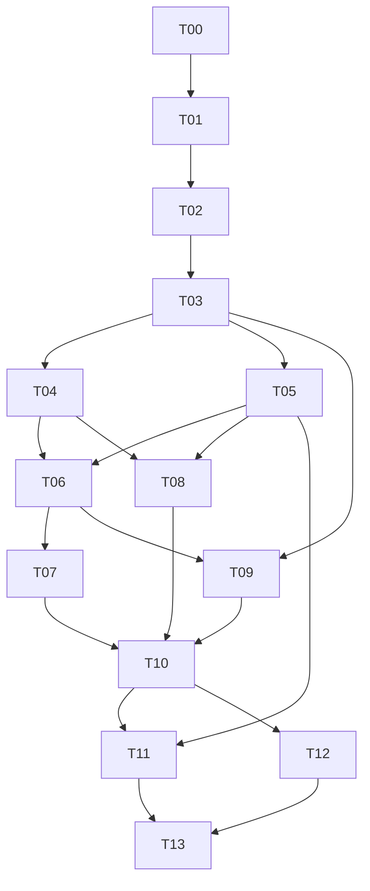

# 可执行任务清单

当前状态：2026-10-11，用户已授权并实现至 P5（T11–T12）。P1 证据见 [记录](p0-p1-report.md)，P2 证据和未覆盖项见 [P2 记录](p2-report.md)。P3 证据见 [P3 记录](p3-report.md)。P4 证据见 [P4 记录](p4-report.md)。P5 证据见 [P5 记录](p5-report.md)。T11 真机待环境，T12 见隔离恢复证据，用户随后已授权 P6/T13，当前正在综合验收；完成标准不会仅凭代码存在标为通过。

项目名称按用户确认统一为 Echo；此次命名修订同步文档、客户端产品/显示名、窗口标题和 API 标题，保持已有数据与配对标识兼容。验证：格式、类型和 OpenAPI 一致性检查通过；iOS 模拟器与 macOS 构建通过，两端产物的显示名、Bundle 名称和可执行文件均为 Echo。构建日志为 `.local/echo-name-ios-build.log`、`.local/echo-name-macos-build.log`；该命名修订后的 P3 实现和验证见下方进度表。

每项任务都必须记录：提交/变更文件、验证命令与结果、未覆盖场景、下一任务。不存在代码时，不运行下列拟建测试命令。

## 依赖关系



## T00 — 确定交付基线与文档状态

- **目标**：后续 Agent 不再把 SaaS/单伴侣/双向 MCP 等已排除方向加入首版。
- **文件**：`AGENTS.md`、本目录所有规划文档。
- **修改**：核对用户最新指令、许可证选择、最低系统版本建议和首版范围；确定规划/实现阶段边界；记录 ADR 变动。
- **依赖**：进入编码需用户后续明确开发指令；许可证未定不创建伪定案 LICENSE。
- **验证**：逐项对照产品确认表、任务与验收矩阵；检查内部链接和不存在文件的表述。
- **完成标准**：产品范围无矛盾；必须与延后项清楚；外部未知事实有标记；下一 Agent 能明确从 T01 开始。

## T01 — 仓库、契约、数据库与部署骨架

- **目标**：建立后端与双端的可构建基础，先让协议与领域实体有统一定义。
- **文件**：根 npm workspace/TypeScript 配置；`packages/contracts/`；`packages/server/src/{api.ts,worker.ts,db/}`；`migrations/`；`apps/apple/Companion.xcodeproj`；`deploy/`；CI。
- **修改**：锁定工具链与依赖；TypeBox/OpenAPI 生成；错误和分页 schema；初始 owner/world/room/message/run/outbox/sync migration；API/Worker 启动入口；健康检查；Compose；iOS/macOS 空工程及共享包。仅按本任务所需创建模块。
- **依赖**：T00。
- **验证**：干净环境 `npm ci`、类型/格式检查、Linux 镜像构建、Apple 两目标构建；数据库从空库迁移成功并重复运行无变化；API/Worker 各自能启动并优雅停止。
- **完成标准**：生成契约可重复且无手改漂移；CI 命令写入 README；开发配置不含真实密钥；不需要 Redis 或手工改数据库才能启动。

## T02 — 单主人配对、设备撤销与凭据保护

- **目标**：自部署实例可安全配对，用户 Key 能供后台运行且不会被读取接口泄漏。
- **文件**：`modules/pairing/`、`devices/`、`providers/`、`db/`、认证 middleware、对应 contracts/migrations/tests。
- **修改**：本机初始化主人与短期配对码；配对限速/单次消费；访问/刷新令牌、轮换和撤销；设备命名；模型/MCP凭据认证加密；密钥版本；默认 HTTPS 和安全配置验证。
- **依赖**：T01。
- **验证**：配对重放、过期码、暴力尝试、撤销设备、刷新令牌重用、错误主密钥、读配置接口/日志扫描；模拟另一个 owner 证明查询边界。
- **完成标准**：无开放注册或无认证管理员创建接口；撤销后旧凭证不能请求或继续拉 SSE；原 Key 不出现在普通响应/日志；主密钥缺失时明确拒绝启动相关能力。

## T03 — 可靠文本运行的最小纵向流程

- **目标**：客户端可以完全关闭，云端仍可靠完成一轮文本回复。
- **文件**：`modules/runs/`、`llm/`、`rooms/`、`sync/`、`usage/`；outbox dispatcher；模拟模型；初始集成测试。
- **修改**：幂等消息命令、202 ACK、run状态机、持久队列、世界租约和 fencing、可恢复流式保存、最终事务；OpenAI-compatible 文本/工具能力接口；模型 capability 配置；预算/usage 基础；取消和有限重试。
- **依赖**：T02。
- **验证**：同一幂等键重发 10 次；断开请求后模型继续；在入队、生成、最终提交的边界杀 Worker；模拟 429/超时/损坏流/缺失 usage；验证旧租约不能提交。
- **完成标准**：一次命令仅一个权威消息/run 结果；部分结果可识别为未完成；无外部调用期间的长数据库事务；最终消息、状态与 usage 一致；不依赖 SSE 长连接存活。

## T04 — 世界、角色、基础世界书与上下文编译

- **目标**：角色和世界模型到位，输入可追踪并能控制 token 预算。
- **文件**：`modules/worlds/`、`characters/`、`context/`、`lorebooks/`；contracts/migrations；prompt golden fixtures。
- **修改**：角色模板/版本/世界实例、玩家 Persona、世界/房间 CRUD；先实现常驻与关键词世界书、逻辑注入槽位；角色可见性过滤；PromptManifest；token 预算和裁剪；配置修订冲突。
- **依赖**：T03。
- **验证**：同模板两个世界记忆与实例 ID 分离；不同角色 prompt 快照；预算不足/超长人设/中文文本；配置并发编辑返回 409；未授权设定不进入 prompt。
- **完成标准**：服务器完全负责 prompt；同一输入与版本可重建同一规则选择结果；核心人设不被静默截掉；Manifest 能解释来源和裁剪。

## T05 — iOS/macOS 配对、聊天与同步

- **目标**：两个原生客户端实际使用同一云端状态，离线可读缓存和保存草稿。
- **文件**：`apps/apple/Packages/CompanionCore/`；`Features/Connection`、`Worlds`、`Chat`、`Settings`；`iOS/`、`macOS/`；`modules/sync/`。
- **修改**：输入服务器 URL、配对、Keychain 会话、模型配置 UI；世界导航、聊天列表、流式状态；REST生成客户端、持久游标 SSE、增量重连、SwiftData缓存/草稿；切换服务器、410全量同步、显式冲突呈现。
- **依赖**：T03；世界界面在 T04 schema 确定后联调。
- **验证**：iPhone模拟器/Mac双端联调；飞行模式发送后重连；流中切页/重启；设备时钟错乱；旧游标；切服务器后不显示上一实例数据；撤销设备断开连接。
- **完成标准**：双端操作最终一致；不能把本地写入显示为服务器已接收；重连无重复气泡/正文；窗口缩放、键盘操作、动态字体和 VoiceOver 基础可用。

## T06 — 群聊、角色知识与剧情提交

- **目标**：实现核心多角色体验，并先消除跨角色泄漏和剧情竞争。
- **文件**：`modules/rooms/`、`worlds/`、`runs/`、`context/`；世界事件/成员/状态迁移；客户端群聊与剧情面板。
- **修改**：私聊/群聊成员与历史可见性；点名/按规则选择发言者；有限顺序接力；世界事件分类、受限状态补丁、角色知识受众；同世界运行串行、用户命令优先；受限最后一轮重生成与纠正事件。
- **依赖**：T04、T05。
- **验证**：角色 A 私聊秘密后 B 在群聊中不可获取；成员加入前后权限；两设备同时发命令；角色主观声称不变为客观事实；相同种子发言顺序稳定；用户插入消息不会无限等自动轮次。
- **完成标准**：最多 8 名角色、每轮最多 3 条默认回复生效；任何角色只拿到其上下文；消息与剧情状态同时提交；有外部副作用或后续依赖时拒绝透明重生成。

## T07 — 长期记忆、来源、检索与遗忘

- **目标**：持久连续性建立在真实经历与可纠正数据上。
- **文件**：`modules/memory/`、`recaps/`、`context/`；向量与证据迁移；客户端 Memory 界面；`tests/evals/`。
- **修改**：按已提交消息游标持久提取；建议以 8 条新消息或空闲 60 秒合并任务，最大处理窗口 40 条；schema校验、证据关联、作用域检查；候选去重/冲突/人工纠正优先；词项+向量检索；模型切换索引版本；遗忘墓碑和派生内容失效。
- **依赖**：T06。
- **验证**：重复事实、日期/偏好变化、秘密、角色谎言、用户纠正、原文删除、旧任务迟到、嵌入服务失败、不同向量维度；人工合成中文查询集测 recall@5。
- **完成标准**：每条自动记忆可追溯；不扩大来源可见性；模型失败不推进水位；没有embedding仍可降级工作；删除后不能从向量/摘要/旧任务恢复内容；效果与用量报告可重现。

## T08 — 世界书完整首版规则与角色卡导入

- **目标**：支持核心酒馆生态内容，同时诚实呈现兼容范围。
- **文件**：`modules/lorebooks/`、`imports/`；`tests/fixtures/cards`、`lorebooks`；客户端世界书编辑/导入预览。
- **修改**：安全正则、深度/优先级/位置、sticky/cooldown/delay、token预算；JSON/PNG角色卡公共字段映射、原始扩展保留；酒馆世界书子集；预览、冲突策略和批次幂等；记录不执行的功能。
- **依赖**：T04；客户端导入界面依赖 T05。与 T07 独立，但发布前与 T06 的角色可见性联测。
- **验证**：中文关键词、大小写、无效/恶意正则、超预算、同请求重试不推进计数；损坏PNG、超大输入、未知字段、v2/v3冲突优先级、重复导入；含脚本/恶意URL不被执行或请求。
- **完成标准**：声明字段的 golden fixtures 全过；导入报告逐项列出不支持行为；不能把部分兼容称为完全兼容；失败无半成品；后续导出保留未知扩展。

## T09 — 外部 MCP 网关与动作权限

- **目标**：角色能使用外部工具，但权限、副作用和失败结果可控制。
- **文件**：`modules/mcp/`、`approvals/`、`providers/`、`runs/`；客户端 Connections/Approvals/Activity；假 MCP 服务。
- **修改**：Streamable HTTP、声明范围内的旧 SSE 适配；工具发现、schema能力、命名冲突；Bearer/API Key凭据；工具grant、长期窄授权、逐次审批；连接和工具输出上限；SSRF/重定向防护；未知副作用状态与审计；不实现MCP Server或STDIO进程启动。
- **依赖**：T03、T06。
- **验证**：读工具、待批准写工具、参数更换、schema改变、授权撤销、过期批准、内网目标、DNS/重定向、恶意结果提示词、超长结果、401/429/断线；写入发生后响应丢失不重复调用。
- **完成标准**：模型不接触凭据；未经授权零写入；批准绑定具体动作；挂起不锁死世界；工具返回无权修改授权；兼容矩阵明确标注OAuth/STDIO不支持。

## T10 — 自主调度、无人剧情和离线回顾

- **目标**：兑现关闭所有客户端仍能持续处理的核心差异。
- **文件**：`modules/autonomy/`、`usage/`、`runs/`、`recaps/`；客户端世界自主设置/回顾/用量；调度迁移。
- **修改**：持久下一次触发；规则预筛+必要时模型决策；总/世界/类别开关；每轮和每日预算预留结算；时区/静默/冷却；主动联系与无人群聊；开关版本的提交验证；有界积压恢复；按事件生成可追溯回顾。
- **依赖**：T07、T08、T09。
- **验证**：虚拟时钟跨日/夏令时、离线24小时、服务暂停后恢复、耗尽预算、同时关闭开关、新用户插入、多个世界争预算、模型返回skip、反复重试；全部客户端关闭仍执行。
- **完成标准**：一晚没有客户端仍产生受限且可追踪的事件；不是预生成假装实时；开关生效可测；超限不调用模型；自动任务不递归形成无限循环；回顾与原文一致。

## T11 — 可选推送中继与真机集成

- **目标**：不暴露官方 APNs 密钥，仍支持自部署实例向官方 App 通知。
- **文件**：`packages/push-relay/`；`modules/notifications/`；Apple通知注册/点击路由；中继部署/隐私说明。
- **修改**：设备注册、投递票据绑定/撤销、环境与topic校验、限速；固定文案和随机事件标识；持久消息后发送；APNs token失效处理；可选开关；自签名用户的自有中继路径。
- **依赖**：T05、T10；真实验证需 Apple团队/Bundle ID和签名权限。
- **验证**：抓取模拟中继请求确认无正文/角色名/记忆/Key；未授权票据不能投递；sandbox/production隔离；中继不可用不阻塞消息；真机测试通知允许/拒绝、前台/后台/锁屏/强退/离线/点击拉取。
- **完成标准**：真实设备结果与限制记录齐全；不以APNs受理等同送达；没有Apple凭据时只标记模拟协议验证完成，不伪称真机通过。

## T12 — 自部署、备份、迁移与恢复

- **目标**：普通技术用户可按文档独立部署、升级和恢复。
- **文件**：`deploy/`、`scripts/`、`docs/self-hosting.md`、`docs/recovery.md`、`modules/exports/`、schema migrations。
- **修改**：amd64/arm64镜像、HTTPS/数据卷、健康检查；初始化和配置校验；加密Key轮换；版本化导出；数据库/资源备份；维护模式恢复、data_epoch变更与设备重配；迁移锁、兼容升级和回滚程序。
- **依赖**：T10；备份骨架可在 T03 后提前验证，最终字段完成后重复一次正式演练。
- **验证**：全新Linux环境照文档部署；错误配置/磁盘满/数据库重启；备份损坏/缺主密钥；异机恢复后数据hash与消息数量；旧实例暂停；上一版本镜像兼容/隔离备份回退。
- **完成标准**：备份实际可恢复，不只是成功创建文件；恢复后不出现双实例后台执行；升级失败不丢原数据；文档包含完整配置与故障定位，不依赖作者口头步骤。

## T13 — 综合回归、模型评估与内测交付

- **目标**：交付一个经过验证的完整首版，而不是只有功能入口。
- **文件**：`tests/`、Apple测试、CI、`docs/acceptance.md`、版本记录、部署说明。
- **修改**：补齐验收追踪表；性能与容量报告；模型能力/效果矩阵；隐私与中继数据清单；无障碍和双端体验；生成版本化构建/镜像及已知限制。
- **依赖**：T11、T12，且 T00–T10 的必要验收均完成。
- **验证**：按验收文档执行完整场景；真实模型至少两种配置；真机通知；2 vCPU/4 GiB基准负载；24小时无人运行和恢复演练；清洁环境重建。
- **完成标准**：零已知严重权限/丢数据/重复现实操作缺陷；所有必须用例有证据；效果阈值未达标则限缩声明或继续修复；测试未做不能写通过；用户能独立完成首次部署与双端使用。

## 建议的验证命令契约

T01 创建这些项目脚本并保证 CI 同步使用：

```text
npm ci
npm run lint
npm run typecheck
npm test
npm run test:integration
npm run test:evals
npm run contracts:check
npm run build
```

`test:integration` 连接专用临时测试数据库，绝不读取生产 `.env`；`test:evals` 默认仅模拟/离线数据，真实模型评估显式选择测试配置和预算。

Apple 工程建立 `Companion-iOS`、`Companion-macOS` schemes。T01 根据当时 Xcode/模拟器实际可用目标记录完整 `xcodebuild` 命令；真机签名和通知任务与无签名构建分开。

这些脚本和工程已在 P1 建立；具体验证结果见实施记录。`test:evals` 已运行 100 条中文合成查询，不代表真实模型效果评估通过。

## 任务进度记录

| 任务       | 状态                                 | 证据、未决与下一步                                                                                                                                    |
| ---------- | ------------------------------------ | ----------------------------------------------------------------------------------------------------------------------------------------------------- |
| 规划与调研 | 文档已产出                           | 固定外部源码来源；未运行竞品                                                                                                                          |
| T00        | 已完成阶段基线                       | 用户 2026-10-10 授权；ADR-014；许可证保留待定，不创建伪定案 LICENSE                                                                                   |
| T01        | P1 验证通过                          | npm/TypeBox/OpenAPI、迁移、容器、CI 与双端工程；[实施记录](p0-p1-report.md)；远程 CI 未运行                                                           |
| T02        | P1 确定性验证通过                    | 配对/撤销/令牌轮换、AES-GCM 与 owner 边界；主密钥版本已保存，再加密轮换属 T12                                                                         |
| T03        | P1 故障验证通过                      | 真实 PostgreSQL、假模型、SIGKILL 重启；无真实 Key，模型兼容效果未验证；下一步 T04/T05                                                                 |
| T04        | 实现与确定性验证通过                 | 世界/模板版本/独立实例/基础世界书/编译与 Manifest；中文 golden、预算、修订和隔离测试；下一步 T07/T08                                                  |
| T05        | 实现；分平台验证                     | 共享 REST/Keychain/SwiftData/SSE/分页快照与业务 UI；模拟器端到端和 Mac 手动联调，Mac XCTest 环境、真机及完整无障碍仍未验证；见 P2 记录                |
| T06        | 实现与确定性验证通过                 | 固定受众、有限接力、世界顺序、声称/纠正、受限重生成；无真实模型效果声明；T07/T09 接入时继续验证依赖与副作用保护                                       |
| T07        | 已实现；确定性与合成检索验证         | 持久提取、来源交集、纠正/冲突、词项与版本化向量、遗忘竞态、后台预算、客户端记忆管理；真实模型与容量未验收；见 [P3 记录](p3-report.md)，下一步 T09/T10 |
| T08        | 已实现；按兼容子集验证               | RE2/持续/冷却/延迟与原子提交；v2/v3 JSON/PNG/世界书预览、幂等、原件保留；未知行为逐项报告；见 [P3 记录](p3-report.md)，下一步 T09/T10                 |
| T09        | 已实现；按声明协议与 schema 子集验证 | 官方 SDK、审批/长期窄授权、SSRF/凭据、未知结果与恢复、Apple 活动界面；见 [P4 记录](p4-report.md)，真实远程 MCP 尚未验证                               |
| T10        | 已实现；确定性及模拟器纵向验证       | 总/世界/类别开关、持久调度、预算、时区与限额、原文回顾、客户端关闭后执行；见 [P4 记录](p4-report.md)，24 小时墙钟压力与真实模型待验收                 |
| T11        | 实现与模拟协议验证，真机待验收       | 持久无正文推送、邀请/票据/环境/限流、HTTP/2 APNs 适配、双端注册与认证路由；用户稍后提供 Apple 团队/签名环境，详见 P5 记录                             |
| T12        | 实现与隔离容器恢复验证               | pg_dump 校验、数据摘要、空库恢复、删除记录、停源切换、密钥事务轮换、导出/诊断；独立 Linux 主机与真实磁盘故障仍待验收                                  |
| T13        | 实现与本地综合验证；发行验收进行中   | 容量优化、20 段中文剧本与受预算控制的真实评估工具、验收/能力/隐私矩阵、0.6.0 候选包；证据、未决和下一步见 [P6 记录](p6-report.md)                     |

2026-10-11 T05 补充修复：iOS 模拟器默认启用本地签名，解决 Xcode Run 再次安装无签名包造成 Keychain 读写失败；Device Hub 实际重新配对并经 Xcode Run 重启后保持已连接。证据见 P2 实施记录的 Device Hub 登入修复；真机与发行签名仍待验证。

### P5 执行证据与下一步（2026-10-11）

用户明确授权 T11–T12。迁移、OpenAPI、API/Worker、可选中继、Apple 双端界面与运维命令已接通。可复现命令、日志路径、通过数量及未验证边界以 [P5 实施记录](p5-report.md) 为准，不以代码存在或 APNs 接受状态代替真机送达。T11 下一步是用户提供团队/签名环境后的物理设备矩阵；T12 下一步是独立主机、公网 HTTPS、真实磁盘故障。此为 P5 阶段结论；用户随后已授权 T13，执行见下文，不将首版综合验收提前标记完成。

### P6 执行证据与下一步（2026-10-11）

用户“继续进行P6的实现”授权 T13。实施 006 快照分块迁移、上下文批量查询、Apple 缓存改进，建立专用容量/耐久工具、20 段中文剧本与预算/人工评分工具、验收追踪/兼容/隐私清单和版本化本地候选包。准确命令、结果、已知限制见 [P6 报告](p6-report.md)。T13 保持进行中；没有真实模型配置、签名真机和独立部署证据时不将相应门槛抹平。

本轮集成 102 项、单元 25 项、Swift 8 项和十分钟容量测试通过；大字体布局修复已编译，UI 复测、最终运行镜像与完整 24h 测试受 Docker 失联阻塞。用户明确选择不重启 Docker，保留已完成结果和 0.6.0 候选源码包。下一步在环境恢复后补齐这些验证，再继续真实环境门槛；不将残留的 soak `running` 当作持续运行或通过。

### T05/T13 UI/UX 优化（2026-10-11）

用户要求依据参考图和设计文档优化界面。实施共享暖色/深色设计系统、私聊/群聊消息布局、上下文菜单、长输入说明、保留历史滚动位置、Mac 键盘输入、会话导航与设置行；修复自主及实体表单的滚动/标签/校验/时间选择，并统一中文错误反馈。没有后端接口或数据库迁移。详细文件、可复现测试、截图、未覆盖边界和后续项见 [优化记录](ui-ux/2026-10-11/design-refresh.md)。此为 T05 体验修订和 T13 局部验证，T13 发行门槛保持进行中。
