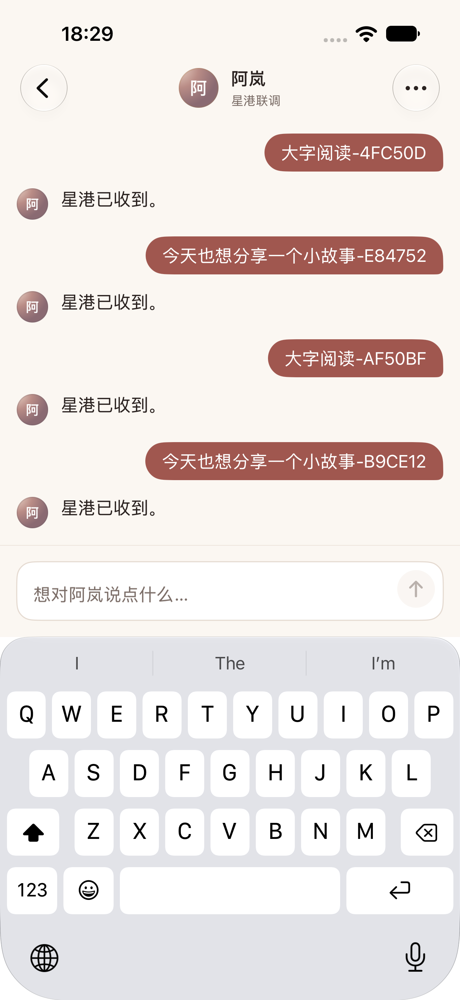
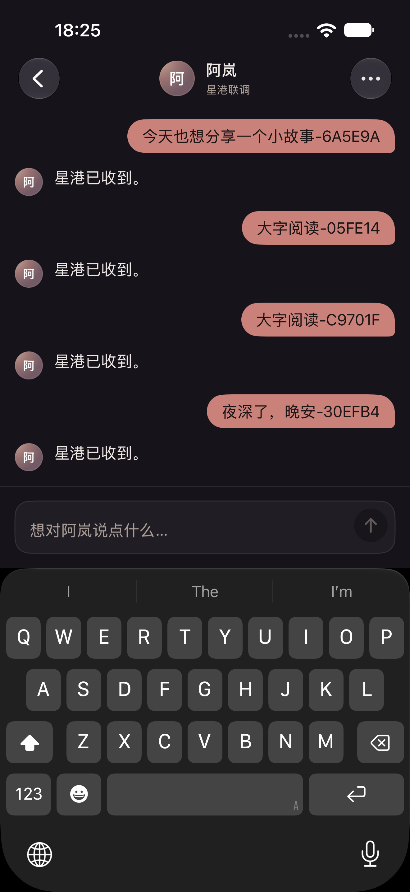
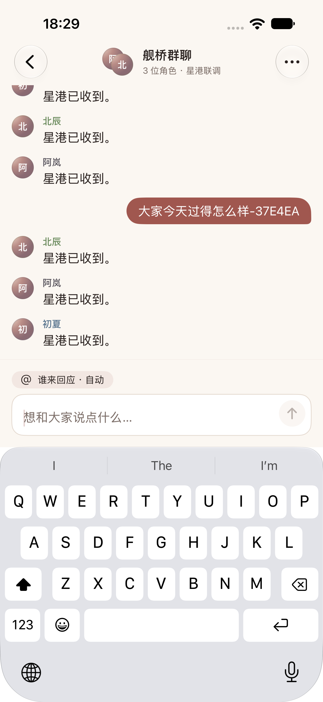
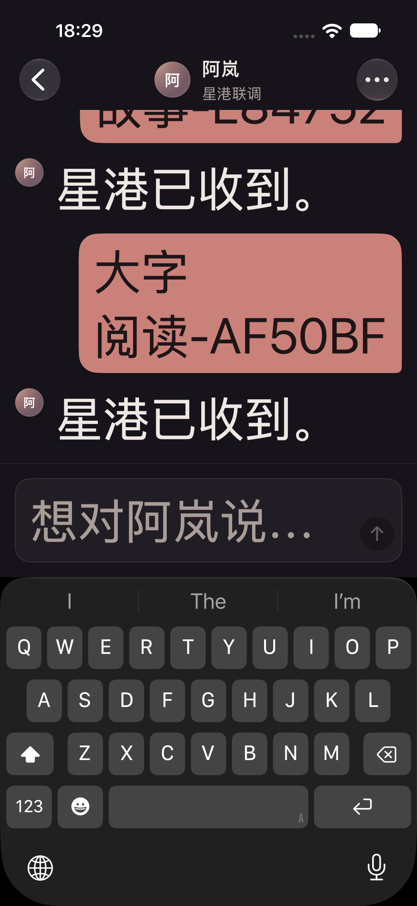
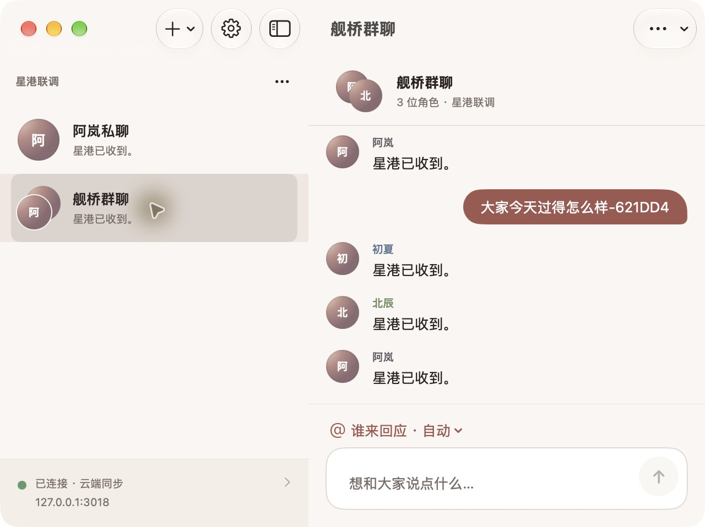
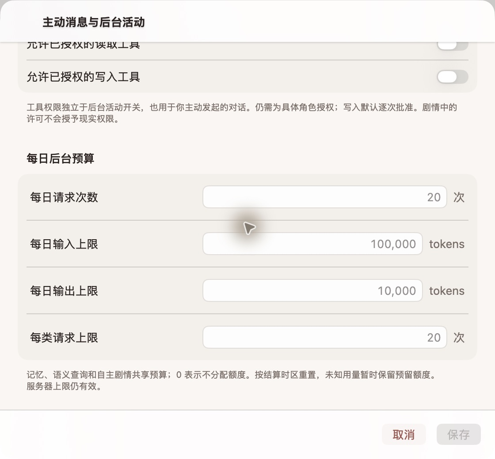

# Echo UI/UX 优化记录

日期：2026-10-11。依据用户提供的 `echo-design-spec.md` 和聊天对比图实施，结合此前 `.local/ui-ux-20261011` 审核资产。第三方规范中的“情侣应用”定位不替代已确认的多角色、共享世界、群聊与剧情范围。

## 已实现

- 共享浅/深色 DesignSystem：暖象牙、暮玫、暖墨，头像占位、身份色、字体/间距/动效 token。辅助文本采用更清楚的次要色；深色三级文字较参考值略提亮。
- 聊天：用户右侧气泡、角色无卡片正文，私聊省略重复名字，群聊显示名字/身份色和点名菜单；按真实时间与身份合并连续消息、插入时间分隔。正常完成不显示状态。
- 复制、引用、换一种回答进入长按/右键菜单；换回答说明整轮替换，并继续服从服务端最后一轮/副作用规则。停止回应、剧情、回忆、主动设置、工具审批集中在菜单。
- 输入：自然占位、图标发送、接近 16,000 字时计数、超长说明、离线本机保存提示；Mac Enter 发送、Shift+Enter 换行，原生组合输入保护。短历史、键盘变化和历史阅读使用明确的滚动目标；把用户的跟随意图与实际滚动位置分开，阅读历史不会被新回复打断。恢复提问/重新编辑先保护已有草稿。
- 导航与设置：保留世界分组，私聊/群聊显示头像与最后消息，管理进入菜单；空状态有创建/导入动作；连接状态与设置图标行统一。
- 自主/实体表单：Mac grouped 可滚动表单与吸底操作栏、常驻标签/单位、时间选择器、严格数字校验、定位首个错误、未修改不保存、退出确认、冲突后显式重载。工具权限独立于后台开关。重载全局设置不会覆盖世界草稿。
- 导入、记忆、MCP、通知、诊断：主题与标签统一；错误映射为中文原因/恢复提示，隐藏内部异常与敏感细节；读取失败不会冒充“已关闭”或正常状态。

接口/迁移：本轮不改变 REST、同步或数据库 schema。新增 Core 的 ChatPresentation 与中文错误映射仅用于展示；新测试夹具增加合成私聊房间。

## 参考规范的适配边界

- 没有真实作息/在线数据时显示世界名或真实回应状态，不伪造在线点。
- 服务端尚未提供一轮短句分段协议，本轮不延迟或拆分已保存消息。未加入语音、礼物、图片上传、聊天背景、收藏或清空聊天等未接通功能的入口。
- 失败回复提供重新编辑原提问；不把仅允许最后已完成轮次的换回答接口当作失败重试，避免重放现实工具。
- 保留契约 16,000 Unicode code points、120–10,080 分钟间隔和现有角色/预算上限，没有照抄参考中的 2,000 字/15 分钟示例。
- 头像使用暖色首字占位；上传图像选取与用户自定义身份色未在本轮新增。正文支持 Dynamic Type，固定圆形中的装饰字形使用默认尺寸，避免最大辅助字号溢出；发送圆为 36pt，实际点击区为 44pt。

## 验证环境与证据

使用本机 PostgreSQL 18.3 的新隔离目录 `.local/design-refresh/pgdata`，端口 55419，专用 `echo2_test`；模拟模型/MCP，API 3018。没有使用真实聊天或模型 Key，没有重启 Docker。此测试环境不作为发行数据库版本验收。验证后已关闭本轮 API/worker 和独立 PostgreSQL，保留日志与数据目录供复查。

- 格式与类型：`git diff --check`、Swift 格式检查、相关 Markdown/夹具格式检查及 TypeScript 类型检查通过。
- Swift Core：18 项通过，覆盖同步缓存、连接策略、消息分组/字符上限与错误脱敏；日志 `.local/design-refresh/swift-final.log`。
- macOS 构建通过：`.local/design-refresh/mac-final.log`。
- Mac 实际窗口核查：私聊与三角色群聊、紧凑输入栏、Enter/Shift+Enter、可滚动自主表单、最后预算字段和独立保存栏；22:30/08:00 原样显示。截图见下方。
- Native NSTextView 检查：10 项通过，覆盖中文组合期间重绘、提交与草稿同步；脚本留在 `.local/design-refresh/mac-ime-harness.swift`。未将它等同于系统拼音候选窗口的完整自动化。
- 原有离线发送/重启/重连去重通过：`.local/design-refresh/ios-ui-v2.log`。通知设置/导出/冷启动原文路由、深色私聊、超长输入通过：`ios-follow-final.log`。
- 截图检查发现并修复：短历史在键盘展开时滚出可视区、最大字体头像/发送图标溢出、长历史里内容增高误关闭自动跟随。现在发送测试同时要求后端完成与最新回复实际可见；滚动几何只决定位置与按钮，手动阅读意图单独保存。
- 最终补测通过：`ios-history-final.log` / `.xcresult` 两项均通过——最大动态字体（含上翻历史及回到最新消息断言）、浅色私聊/群聊/表单。iOS 构建随 test 成功。
- 修正测试自身的最大字体配对滚动、长草稿清理隔离，以及 lazy Form 中先滚到具体预算字段再检查的定位方式。失败尝试保留在 `.local/design-refresh/`，不计为通过。
- Mac 追加手测：向上阅读期间收到其他设备的新消息，原位置保持；“回到最新消息”按钮可返回末条回复。

截图均来自合成数据与模拟回复，不代表真实模型的对话效果。













## 复现

```sh
swift test --package-path apps/apple/Packages/CompanionCore
xcodegen generate --spec apps/apple/project.yml
xcodebuild -project apps/apple/Companion.xcodeproj -scheme Companion-macOS -derivedDataPath .local/macos build
# 先启动专用测试 PostgreSQL；此夹具会清空 echo2_test 合成库，不可使用业务库。
TEST_DATABASE_URL=postgresql://echo_ui@127.0.0.1:55419/echo2_test \
  ECHO_UI_PORT=3018 ECHO_UI_HOST=127.0.0.1 node --import tsx tests/fixtures/p2-ui-server.ts
# 在另一个终端运行，模拟器 ID 按本机实际设备替换。
xcodebuild -project apps/apple/Companion.xcodeproj -scheme Companion-iOS \
  -destination 'platform=iOS Simulator,id=34F8DBDA-87C9-4518-960E-56D6A03321CB' \
  -derivedDataPath .local/ios ECHO_UI_BASE_URL=http://127.0.0.1:3018 \
  -only-testing:Companion-iOS-UITests/CompanionUITests/testUIRefreshDarkChat \
  -only-testing:Companion-iOS-UITests/CompanionUITests/testUIRefreshLargeText \
  -only-testing:Companion-iOS-UITests/CompanionUITests/testUIRefreshLightChatAndForms \
  -only-testing:Companion-iOS-UITests/CompanionUITests/testUIRefreshLongDraftExplainsLimit test
```

## 未覆盖与下一步

完整 VoiceOver 操作、iPad/横屏、小屏物理设备、真实系统拼音候选流程、全页浅/深/最大字体逐项矩阵仍需补充；本轮验证不改变 T13 的发行待验收状态。涉及真实模型效果、签名、物理通知和长期耐久的原门槛继续保留。
